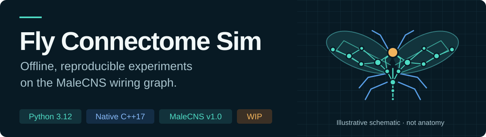
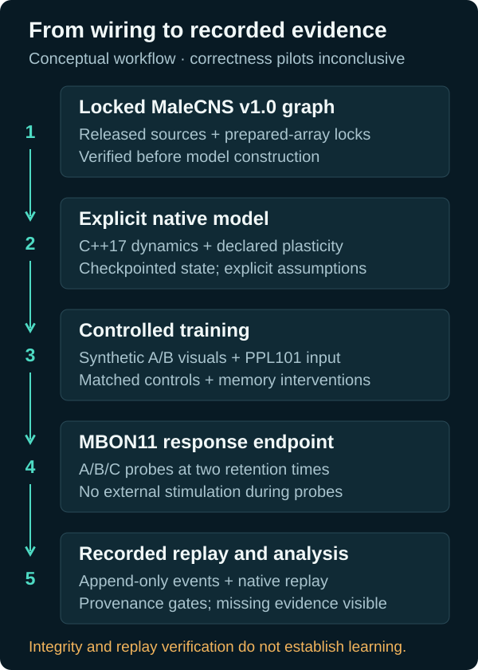

  <a href="#current-status">Status</a> ·
  <a href="#the-assay">The assay</a> ·
  <a href="docs/getting-started.md">Getting started</a> ·
  <a href="#provenance">Provenance</a>

An offline experiment built on the released **MaleCNS v1.0** wiring graph.
The first goal is to test a declared KC → MBON11 associative-plasticity mechanism
using controlled visual stimuli and explicit PPL101 stimulation.

**Work in progress: native correctness pilots have not established scientific support.**
Formal full-graph qualification and confirmation have not run. Bounded fullgraph
resource pilots have run, but whole-assay capacity and a production frozen
configuration have not been established. No positive
plasticity or learned-behavior result is claimed.

The graph supplies wiring and annotations. Physiology, plasticity and action
mappings are explicit model choices. This is not a complete living fly, and it
does not establish consciousness, semantic understanding, dopamine concentration
or receptor occupancy. The MBON11 endpoint does not establish a learned
left/right preference.

## Current status

| Area | Implemented | Still to establish |
| --- | --- | --- |
| Data | Checksum-locked MaleCNS v1.0 sources; prepared graph verified at **166,700 cells** and **25,582,938 directed edges** | Formal assay qualification and confirmation on the full graph |
| Native model | C++17 kernel; explicit PAM11/PPL101 stimulation; KC, MBON07, MBON11 and DNa02 telemetry | Physiological validity beyond the declared model |
| Experiment state | Checkpoint restore, complete-state hashes, reset determinism, candidate-memory interventions and authenticated native map/schema context | A qualified production frozen configuration |
| Assay evidence | Caller-owned native production, source-specific 408-pair tiny-native repeats, shared declaration arithmetic and a bounded pair checker with full EOF validation | Global grid/selected-evidence reconciliation/public freezing, fullgraph held-out confirmation and the `assay` CLI |
| Resource pilots | Fullgraph components, trained 10-/70-second one-anchor pilots with isolated native replay, and a [reviewed detail-on first-training-prefix sample](docs/experiments/2026-11-02-fullgraph-detail-prefix-pilot.md) | Unprofiled controlled timing, complete grid/assay capacity and a tested cloud/Linux environment |
| Product | A/B and real-video replay with inspected 30fps export; strict event proposals, measured motor selection and bound event-plan export | Live LLM transport, longer feed sessions and accessibility/cross-browser polish |

The [event-choice contract](docs/superpowers/specs/2026-11-02-event-choice-milestone.md)
adds two imported event concepts, deterministic visual cards and a fresh 2s
reward-free observation. The final 500ms motor counts select the left or right
proposal, or explicitly defer. The exported plan retains the chosen proposal
exactly; an LLM cannot override that selection. Start with the small
[example](examples/event-options.json) or [proposal prompt](docs/event-proposal-prompt.md).
This imports JSON; it makes no live model/API call or paid request.
One bounded actual run selected Sunset House from final left2/right1 spikes;
same-artifact Chrome/plan-download and150-frame/5s export checks passed. See the
[event-choice report](docs/experiments/2026-11-02-event-choice-observation.md).

The motor readout is an engineered display policy with an uncalibrated 1 Hz
threshold. It uses measured lateral motor rates and leaves the primary MBON11
classification unchanged; it does not establish learned behavior.

Measured Replay remains experimental WIP. The current [fast-feed contract](docs/superpowers/specs/2026-11-02-fast-reel-feed.md)
adds an explicit `fast-feed` profile: 5× source-content sampling, 3s minimum
watch time and a 4s clip cap. After recorded ADVANCE, an illustrative foreground
leg reaches onto the display, swipes it and retracts in400ms; the synchronized
content stroke takes200ms.
Simulation stays at normal time; media PTS and replay speed are separate clocks.
Default `standard` preserves the original 1×/v1 protocol. The swipe combines
actual fed outgoing/incoming frames for presentation; it is not neural input.
Source review, focused tests and the actual 7s fast-feed pilot/raw/parser audit
passed. Chrome/boundary checks and the actual 225-frame/7.5s export passed,
including a labelled 0.5s presentation hold. See the [current handover](docs/cloud-handover.md),
[fast-feed plan](docs/superpowers/plans/2026-11-02-fast-reel-feed.md)
and [video commands](docs/getting-started.md#local-video-observation-and-recorded-feed-actions).
The earlier [12s A/B](docs/experiments/2026-11-02-measured-replay-observation.md)
and [3.5s standard-video](docs/experiments/2026-11-02-video-feed-observation.md)
observations are separate historical evidence, not fast-feed measurements.

Implementation and verification details live in the
[assay plan](docs/superpowers/plans/2026-09-24-associative-plasticity-assay.md).
The [assay design](docs/superpowers/specs/2026-09-24-associative-plasticity-pivot-design.md)
defines the scientific boundaries; the [product specification](docs/specs/fly-event-planner.md)
describes the broader event-planning goal; live LLM transport remains open.

For a fresh cloud checkout, start with the versioned
[cloud handover and live TODOs](docs/cloud-handover.md). Local runtime data,
toolchains and private working notes are not part of the repository.

## The assay

Present synthetic A/B stimuli, pair one with PPL101 stimulation, then measure
A/B and neutral C probes **without external stimulation**. Compare matched
controls and necessity, sufficiency and sham interventions at two retention
times using the frozen MBON11 response endpoint.

- **Locked inputs:** released source checksums, normalized metadata and prepared
  array locks gate model construction.
- **Controlled state:** counterbalanced protocols, complete-state validation and
  separate candidate/noncandidate content hashes support auditable interventions.
  Content equality alone does not prove donor history or clock compatibility.
- **Recorded evidence:** append-only events, durable retention anchors and
  isolated native replay support validated-prefix and sealed reports. Missing
  assay cells remain visible and yield an inconclusive result.

The ordinary `verify-run` command checks artifact integrity. Native replay is a
separate verification path; an intact artifact is not evidence of learning.

## Getting started

The native/data Windows workflow was exercised with **Python 3.12.14**,
**uv 0.12.15**, **Zig 0.16.0** and **Node.js 25.9.0**. The replay viewer was
checked separately with **Node.js 24.21.0 / npm 11.19.0** and requires Node >=24.
The numerical kernel uses C++17; Python coordinates experiments and Node.js
downloads the released data and serves/builds the local viewer.

Follow [Getting started](docs/getting-started.md) for the complete toolchain
setup, locked data download and verification, preparation, experiment commands
and tests. Allow space for the 1.1 GB source download plus generated outputs.
Linux/macOS have an existing build path; that environment has not been locally
verified or compiler-pinned.

## Provenance

The numerical core is adapted from MIT-licensed Stonkfly/DOOMFLY work through a
checksum-pinned Fly/Wirehead revision. Exact revisions and the retained notice
are documented in [THIRD_PARTY.md](THIRD_PARTY.md) and
[the upstream MIT notice](licenses/stonkfly-MIT.txt).

MaleCNS data is distributed separately under **CC BY 4.0**. Attribution and
citation details are provided by the
[official MaleCNS release](https://male-cns.janelia.org/download/). Raw data and
generated runtime artifacts remain outside Git. These third-party terms do not
declare a license for the project-owned code.
